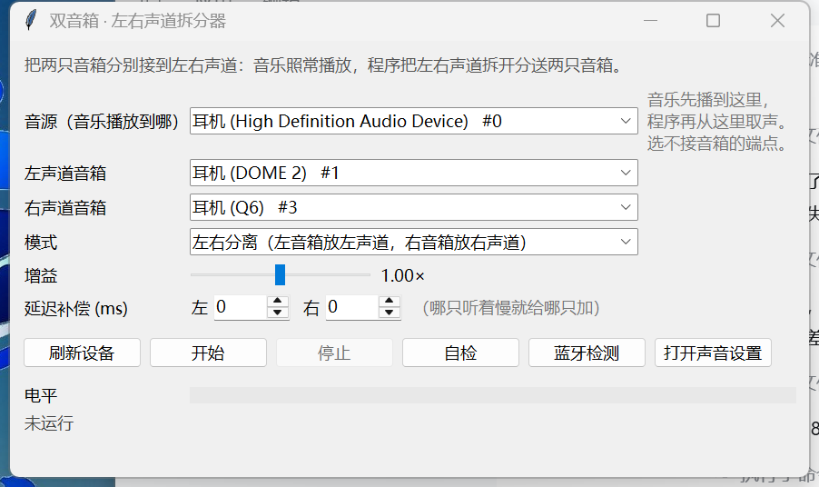

# 双音箱左右声道拆分器

把两只普通蓝牙音箱变成一对左右声道音箱：左音箱只出声左声道，右音箱只出右声道。

**不想装 Python？** [下载便携版（Windows 64 位，22 MB）](https://github.com/zhuwencong/bt-stereo/releases/latest)，
解压双击 `bt-stereo.exe` 即可。



两只蓝牙音箱各自是独立设备，Windows 本身没有"把两只箱子组成一对"的功能，所以这里用
**WASAPI 回环捕获 + 双路输出** 来做：程序从系统正在播放的声音里取一份，把左声道送给
A 箱、右声道送给 B 箱，并实时补偿两只箱子之间的时钟漂移。

> **English**: Send the left/right channels of Windows audio to two separate output devices
> (two Bluetooth speakers, or one Bluetooth + one wired) using WASAPI loopback, with automatic
> clock-drift compensation and latency alignment. Pure Python — only `numpy` + `comtypes`,
> no `soundcard` / `sounddevice` / virtual audio cable required.

```
 音乐播放器 ──► 某个"音源"端点（比如板载声卡 / 显示器 HDMI）
                        │  WASAPI loopback 捕获
                        ▼
                    ┌────────┐
                    │ 声道拆分 │
                    └───┬────┘
              ┌─────────┴─────────┐
              ▼                   ▼
        左声道 → 音箱 A      右声道 → 音箱 B
        （复制成双声道）      （复制成双声道）
```

## 零基础上手（四步，不需要懂代码）

1. **下载**：在 GitHub 页面点绿色 `Code` → `Download ZIP`，解压到任意目录
   （Gitee 用户点「克隆/下载」→「下载 ZIP」，国内网速更快）
2. **装 Python**：<https://www.python.org/downloads/> 下载 3.10 以上版本，
   安装时**务必勾选 `Add python.exe to PATH`**
3. **双击 `setup.bat`**：自动安装 `numpy` 和 `comtypes`，看到"安装完成"即可
4. **双击 `启动.bat`**：选好左/右音箱，点「开始」，然后正常放歌

> 装好之后日常使用只需要第 4 步。程序会记住你的选择，下次双击就是上次的配置。

## 更懒的用法：把链接丢给 AI

不想自己折腾？把这个仓库地址发给任意 AI 助手（豆包 / DeepSeek / ChatGPT / Claude / Codex 都行），
再补一句：

> 帮我装一下这个，我电脑是 Windows：https://github.com/zhuwencong/bt-stereo

仓库根目录的 [`AGENTS.md`](AGENTS.md) 就是专门写给 AI 看的安装说明：环境检查 → 装依赖 →
蓝牙体检 → 启动 → 验证，还标了"不要动驱动、不要写注册表"这类边界。AI 读到它就能一次装对，
不用你在旁边一步步教。

## 一、开始前

1. 两只音箱都要先在 Windows 里配对并**同时连接**上（设置 → 蓝牙和设备 → 设备）。
   连上后它们会各自出现在"播放设备"列表里，名字通常带 `Stereo` 或 `立体声`。
2. 电脑的蓝牙适配器要支持**同时**连两个 A2DP 音频设备。蓝牙 5.0 以上的适配器一般可以；
   如果系统里永远只出现一只音箱，那是适配器/驱动的限制，软件层面无法绕过
   （可外接一个蓝牙 5.3 适配器，或用两只音箱自带的 TWS 功能）。
3. 两只箱子**型号不同也没问题**——这正是本程序要做的事。

## 二、运行

双击 **`启动.bat`**（图形界面），或双击 **`命令行.bat`**（终端交互）。

界面上只有三件事要选：

| 选项 | 选什么 |
| --- | --- |
| 音源（音乐播放到哪） | 音乐**实际输出**的那个设备。**不能**选左/右音箱本身，否则自我循环。 |
| 左声道音箱 | 放在左边的箱子 |
| 右声道音箱 | 放在右边的箱子 |

选好点 **开始**，然后用任意播放器放歌即可。

界面上有个勾选项 **"自动把系统默认播放设备切到「音源」"**（默认勾上）：点开始时程序会把
Windows 默认输出切到音源端点，停止时自动切回原来的设备。所以正常流程只有一步——**点开始**，
不用再去声音设置里手动选设备。

### 关于"音源"这个坑

程序必须能"听到"音乐，所以音乐要播到一个能被捕获的端点。推荐做法：

- **最稳的拓扑：一只有线音箱 + 一只蓝牙音箱。** 有线那侧时钟稳定、延迟接近 0，
  蓝牙那侧约 150~250ms，用"延迟补偿"把有线那侧往后推同样的量即可。两只蓝牙同时用
  也能跑，但两台设备的时钟差要靠程序实时补偿，效果不如"有线+蓝牙"干净。
- 音源用**虚拟声卡**（比如 ToDesk Virtual Audio）或**没接喇叭的 HDMI**，它们不会真的出声，
  不会和两只音箱重复。把系统默认播放设备（或只把音乐播放器的输出）切到它即可。
- 板载声卡也可以当音源，但插着东西会跟着响，音量拉到很小即可（**不要静音**）。
- **不要用 S/PDIF 当音源**：实测这个端点的回环数据断断续续，会把声音切碎。

## 三、调节

- **延迟补偿**：两只箱子的蓝牙编解码器不同（SBC / AAC / aptX），延迟可能差几十毫秒。
  放一段有人声或鼓点的音乐，如果听起来像"回声"，给**听起来慢的那只**加 20~80ms，
  直到声音重新合在一起。这个值会被记住。
- **增益**：默认 1.0。若两台音量不一致，可整体调整（每只箱子单独调请用音箱自己的音量键）。
- **模式**：
  - `左右分离` —— 正常用法；
  - `两边都放完整立体声` —— 相当于双份外放，适合两台箱子放在同一房间不同角落；
  - `左右互换` —— 摆反了的时候用。

## 四、命令行

```bat
python -m bt_stereo --cli list
python -m bt_stereo --cli run --left 3 --right 4 --source 0
python -m bt_stereo --cli run --left Q6 --right DOME --source 耳机 --delay-left 40
```

参数说明：

| 参数 | 含义 |
| --- | --- |
| `--left` / `--right` | 编号或名字片段 |
| `--source` | 音源端点，省略则用系统默认 |
| `--mode` | `lr` / `swap` / `duplicate` |
| `--delay-left` / `--delay-right` | 额外延迟（毫秒） |
| `--gain` | 增益 |
| `--target-ms` | 缓冲目标深度，默认 80ms，越小延迟越低但越容易卡 |

不加 `--left/--right` 时会进入交互式选择。

## 五、自检与测试

```bat
python -m bt_stereo --cli doctor      :: 体检：适配器型号/驱动、配对设备、能不能双连
python -m bt_stereo --cli test        :: 枚举设备 + 播 1.5 秒测试音并回环录回来
python tests\test_split.py            :: 闭环验证左右分离（自动挑 3 个端点）
python tests\test_stability.py        :: 20 秒静音稳定性测试（不吵人，看水位和欠载）
python tests\test_gui_flow.py         :: 无人值守跑一遍界面流程
python tests\test_doctor_window.py    :: 验证"蓝牙检测"弹窗内容
```

`doctor` 会直接给结论：适配器是否正常、哪些音箱"配对过但没连"、当前有几个蓝牙端点，
以及到底能不能双连。界面上对应 **蓝牙检测** 按钮。

`test_split.py` 会往音源播 左=1kHz / 右=3kHz，再把两个输出端点的回环录回来做频谱分析，
正常情况下左箱主频 ~1000Hz、右箱 ~3000Hz、串音接近 0。

## 六、常见问题

**只显示一只蓝牙音箱？**
系统层面没连上第二只。先断开再重连，或换一个 USB 蓝牙适配器。部分笔记本内置蓝牙
只允许一条 A2DP 链路。

**声音断断续续 / 有"咕"声**？
把 `--target-ms` 调大（比如 150）。2.4GHz 频段拥挤、Wi-Fi 干扰、音箱距离过远、
两只音箱抢带宽都会造成断续。采样率不同（44.1k/48k 混用）没关系，程序会自动重采样。

**一只音箱突然没声了？**
蓝牙掉线很常见。程序做了单路隔离：掉的那一路会在状态栏显示"音箱离线/重连中"，
另一只继续正常出声，设备回来后自动接上（按名字重连，因为重连后设备 id 会变）。
如果一直显示离线，去 设置 → 蓝牙和设备 里把那只"断开"再"连接"，
然后点程序里的 **刷新设备**。

**画面和声音对不上？**
蓝牙本身有 100~300ms 延迟，再叠加 80ms 缓冲。看视频建议用播放器自带的"音频延迟"
功能（PotPlayer、VLC 都支持）抵消。

**两只箱子是同一型号，带 TWS 功能？**
那优先用音箱自己的 TWS 配对：按说明书让两只箱子互连，电脑只连其中一只，
系统里会出现一个"立体声"设备，左右声道天然正确，没有漂移问题。本程序是给
"不支持 TWS / 两只不同型号"的情况兜底的。

**为什么不用"立体声混音"？**
那是声卡的录音输入，和 WASAPI 回环是两件事；回环捕获更通用，不依赖驱动是否提供
"立体声混音"选项，音质也不经过额外的模拟回路。

## 七、实现说明

- `bt_stereo/wasapi.py`：`comtypes` + ctypes 直接调 COM 接口（`IMMDeviceEnumerator`、
  `IAudioClient`、`IAudioRenderClient`、`IAudioCaptureClient`），不依赖 `soundcard`/
  `sounddevice` 之类需要联网安装的包。
- `bt_stereo/engine.py`：一个环形缓冲 + 两个独立读取器。每个读取器按水位做微小变速
  （上限 ±1%，但每秒只允许滑行 0.2%，所以听不出跑调），把两只音箱各自的时钟漂移
  慢慢吃掉，不会累积成错位；源设备暂停时自动重新预缓冲，不会在 0 水位上跑。
- 采样率不同（比如音源 48kHz、音箱 44.1kHz）会自动重采样，不用手动对齐。
- `bt_stereo/gui.py`：tkinter 界面。
- `bt_stereo/doctor.py`：只读注册表 + `cfgmgr32` 做蓝牙体检。适配器信息来自
  `Enum\USB\*` 的 `ClassGUID`，配对设备来自 `BTHPORT\Parameters\Devices`
  （含 COD 设备类别、LMP 版本换算出的蓝牙规范、上次连接时间）。
- 延迟链路：捕获缓冲 200ms → 目标水位 120ms → 输出缓冲 260ms，实际额外延迟约 150ms 量级。
- 流畅性：启动时调用 `timeBeginPeriod(1)` 把 Windows 定时器精度从 15.6ms 提到 1ms，
  否则音频线程的 sleep 会被拖成一阵一阵（听感就是卡顿）；输出按 ≥12ms 的块写，
  减少线程唤醒次数。实测 20 秒断流 < 0.1%。

需要 Python 3.10+、`numpy`、`comtypes`（本机已具备）。

## 八、项目结构

```
bt_stereo/
  wasapi.py     WASAPI 封装：设备枚举、播放流、回环捕获、默认设备切换
  engine.py     拆分引擎：环形缓冲 + 双读取器 + 漂移补偿 + 故障重连
  doctor.py     蓝牙体检：适配器/配对设备/能否双连
  gui.py        tkinter 界面
  cli.py        命令行
tests/          闭环测试（分离、稳定性、并发、卡顿、自动音源、界面流程）
docs/           界面截图
```

## 九、开源协议

[MIT](LICENSE) —— 随便用，随便改，保留版权声明即可。

欢迎提 Issue / PR。如果你的音箱型号有兼容性问题，把 `python -m bt_stereo --cli doctor`
的输出贴到 Issue 里，能省很多沟通。
